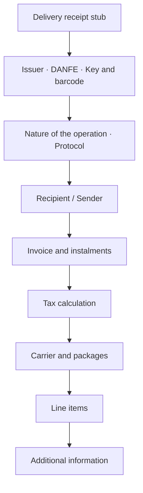
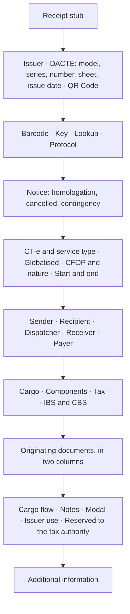

# Auxiliary documents as PDF

The [`danfe`](https://pkg.go.dev/github.com/sisgt-sistemas/gonfe/danfe) package
generates the six auxiliary documents as PDFs.

| Auxiliary document | Fiscal document | Function | Format |
| --- | --- | --- | --- |
| DANFE | NF-e, model 55 | `Gerar` or `DANFE` | A4 |
| Receipt | NFC-e, model 65 | `Gerar` or `Cupom` | till roll |
| DACTE | CT-e, model 57 | `GerarDACTE` or `DACTE` | A4 |
| DACTE OS | CT-e OS, model 67 | `GerarDACTEOS` or `DACTEOS` | A4 |
| Simplificado DACTE | CT-e Simplificado, model 57 | `GerarDACTESimp` or `DACTESimp` | A4 |
| DAMDFE | MDF-e, model 58 | `GerarDAMDFE` or `DAMDFE` | A4 |

```go
proc, _ := os.ReadFile("43260...-procNFe.xml")

documento, err := danfe.Gerar(proc, danfe.Opcoes{})
if err != nil {
    return err
}
os.WriteFile("danfe.pdf", documento, 0o644)
```

The `Gerar*` functions take the distribution XML — `nfeProc`, `cteProc`,
`cteOSProc` or `mdfeProc` — and handle the parsing. `Gerar` additionally chooses
between DANFE and receipt by model: 55 becomes a DANFE, 65 becomes a receipt.
When the document is already parsed in memory, call `DANFE`, `Cupom`, `DACTE`,
`DACTEOS` or `DAMDFE` directly, passing the document and the protocol.

All of them accept the same [options](#opcoes) and paginate automatically.

## No dependencies

The PDF is written in pure Go, using the base-14 fonts every reader already has.
There is no graphics library, no CGO, no embedded font file.

The Code 128 barcode of the access key is drawn as rectangles, with no barcode
library, and switches from set C to set A for the letters of an alphanumeric
CNPJ. The QR Code on the DACTE and the DAMDFE, which the manuals require, is
encoded with `rsc.io/qr` (pure Go, no CGO) from the document's `qrCodCTe` or
`qrCodMDFe`.

!!! warning "On fidelity to the manual"

    The five layouts follow the **block structure** of the technical
    specification manuals, in the order those manuals describe. None is a
    millimetre-accurate reproduction of the official form, and none has been
    visually approved by any SEFAZ.

    Print a sample and check it against your state's requirements before using
    it in production:

    ```bash
    go run ./exemplos/danfe -amostra
    ```

## What the DANFE contains



Pagination is automatic: long invoices take as many sheets as needed, with the
header repeated and "FOLHA n de N" numbering. The identification blocks appear
only on the first sheet; the additional information, only on the last.

## The DACTE

```go
proc, _ := os.ReadFile("43260...-procCTe.xml")

dacte, err := danfe.GerarDACTE(proc, danfe.Opcoes{})
```

The DACTE, the DACTE OS and the Simplificado one follow MOC CT-e 4.00, Annex II
(the DACTE manual):



- **Only what is in the XML.** The manual does not allow text from outside the
  document, and `Mensagem` is not printed on the transport documents.
- **Homologation in the variable area.** The notice "EMITIDO EM AMBIENTE DE
  HOMOLOGAÇÃO – SEM VALOR FISCAL" goes in a band below the key, with no banner
  over the values.
- **Sheets.** The fixed blocks stay on the first sheet; documents that do not fit
  continue on the next ones, which repeat the header (§2.12). The table runs to
  the foot of the sheet, as in the models.
- **The payer is resolved automatically.** When `toma3` points at one of the
  parties, the payer block carries that party's details. A `toma4` is used as
  given.
- **What the manual does not cover** (IBS and CBS, collection orders, ICMS
  sharing) comes in blocks after the standard layout.

## The DACTE OS

```go
dacteos, err := danfe.GerarDACTEOS(procCTeOS, danfe.Opcoes{})
```

It follows the model on p.51 of the manual: the service with the vehicle route,
payer, service quantity and description, amounts, tax, notes, insurance and road
modal. Chartering and referenced documents (BP-e, GTV-e) come afterwards. The
model's receipt stub is optional and is not printed; `SemCanhoto` is ignored.

## The Simplificado DACTE

```go
dacte, err := danfe.GerarDACTESimp(procCTeSimp, danfe.Opcoes{})
```

Neither the manual nor NT 2024.002 defines its layout. This one follows the
manual's general rules — the same header, QR Code, barcode and sheets — and, in
place of sender and recipient, carries the deliveries table: item, origin,
destination, amounts and each delivery's documents, continuing on the next
sheets.

## The DAMDFE

```go
proc, _ := os.ReadFile("43260...-procMDFe.xml")

damdfe, err := danfe.GerarDAMDFE(proc, danfe.Opcoes{})
```

It follows the road model of MOC MDF-e 3.00b, Annex II (§2.7): issuer with RNTRC,
QR Code, identification, totals, tax authority control with the key and the
lookup address, protocol, vehicles, drivers, toll vouchers and notes. In
contingency, the notice with the 168-hour deadline takes the protocol's place.
Below the standard layout, as the manual allows, come the trip, the CIOT,
vehicle details, cargo, insurance and the list of documents by unloading
municipality. The DAMDFE has no receipt stub.

## Options

```go
danfe.Opcoes{
    Orientacao:    danfe.Paisagem,  // default: portrait
    SemCanhoto:    true,            // omits the delivery receipt stub
    Cancelada:     true,            // marks the document as cancelled
    Homologacao:   true,            // forces the test notice
    Mensagem:      "Emitido por Sistema X", // NF-e and NFC-e only
    LarguraBobina: 58,              // NFC-e: 80 mm by default
    QRCode:        matriz,          // NFC-e: see below
}
```

The banners appear on their own when the document calls for them: an invoice in
homologation gets `SEM VALOR FISCAL`, a denied one gets `USO DENEGADO`, and one
without a protocol gets `SEM AUTORIZAÇÃO`.

`Orientacao` rotates the sheet and gives the blocks more width. In the transport
documents the structure drawn is the same in both orientations, and the
document's `tpImp` field is not consulted.

## The NFC-e QR Code

The library produces the QR Code **text** — the URL with its parameters and hash
— but does not encode it into an image. Encoding QR is a domain of its own, with
Reed-Solomon error correction and masking; a poorly tested implementation of our
own would be worse than none.

Pass in the finished matrix, obtained from the QR library of your choice:

```go
import "github.com/skip2/go-qrcode"

q, err := qrcode.New(n.InfNFeSupl.QrCode, qrcode.Medium)
if err != nil {
    return err
}

cupom, err := danfe.Cupom(n, prot, danfe.Opcoes{
    QRCode: danfe.MatrizQR(q.Bitmap()),
})
```

Without the matrix, the receipt comes out with the lookup URL in text and a note
saying the QR Code was not included — readable, but missing the square the
consumer points a camera at.

## The NFC-e receipt

The receipt does not paginate: it comes out as one continuous strip, with its
height computed from the content. The default width is 80 mm, that of the usual
thermal printers; `LarguraBobina` accepts 58 mm and other formats.

```go
cupom, err := danfe.Cupom(n, prot, danfe.Opcoes{
    LarguraBobina: 58,
    QRCode:        matriz,
})
```

The content follows what the NFC-e Technical Note requires: issuer
identification, line items with quantity and unit price, totals, payment
methods, total taxes under Law 12.741/2012, consumer identification, access key,
QR Code and authorisation protocol.

## Printing

The PDF comes out ready to print. On a thermal printer, send the file straight
to the device or convert it with the manufacturer's tool — the page already has
the exact width of the roll, so there is no rescaling.

To serve the document over HTTP:

```go
func baixarDANFE(w http.ResponseWriter, r *http.Request) {
    documento, err := danfe.Gerar(proc, danfe.Opcoes{})
    if err != nil {
        http.Error(w, err.Error(), http.StatusInternalServerError)
        return
    }
    w.Header().Set("Content-Type", "application/pdf")
    w.Header().Set("Content-Disposition", `inline; filename="danfe.pdf"`)
    w.Write(documento)
}
```

## Samples

```bash
go run ./exemplos/danfe -amostra
```

Generates all five files — `amostra-danfe.pdf`, `amostra-cupom.pdf`,
`amostra-dacte.pdf`, `amostra-dacte-os.pdf` and `amostra-damdfe.pdf` — from
demonstration documents, with no certificate and no XML required. It is the
quickest way to judge the layout.

To generate from a real XML, the same command serves them all: the type is
recognised from the root element.

```bash
go run ./exemplos/danfe -xml ./43260...-procCTe.xml
```
