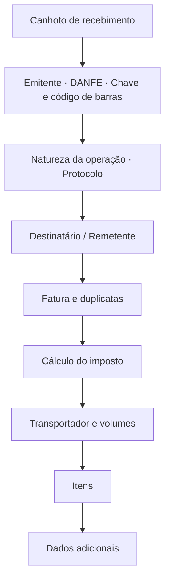
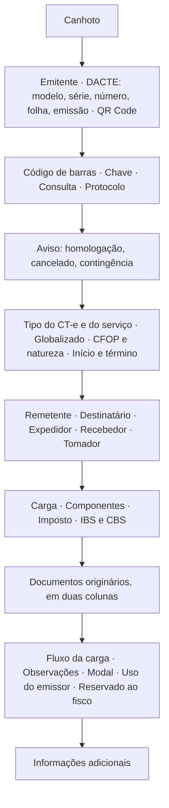

# Documentos auxiliares em PDF

O pacote [`danfe`](https://pkg.go.dev/github.com/sisgt-sistemas/gonfe/danfe) gera os
seis documentos auxiliares em PDF.

| Documento auxiliar | Documento fiscal | Função | Formato |
| --- | --- | --- | --- |
| DANFE | NF-e, modelo 55 | `Gerar` ou `DANFE` | A4 |
| Cupom | NFC-e, modelo 65 | `Gerar` ou `Cupom` | bobina |
| DACTE | CT-e, modelo 57 | `GerarDACTE` ou `DACTE` | A4 ou meia folha (A5) |
| DACTE OS | CT-e OS, modelo 67 | `GerarDACTEOS` ou `DACTEOS` | A4 |
| DACTE do Simplificado | CT-e Simplificado, modelo 57 | `GerarDACTESimp` ou `DACTESimp` | A4 |
| DAMDFE | MDF-e, modelo 58 | `GerarDAMDFE` ou `DAMDFE` | A4 |

```go
proc, _ := os.ReadFile("43260...-procNFe.xml")

documento, err := danfe.Gerar(proc, danfe.Opcoes{})
if err != nil {
    return err
}
os.WriteFile("danfe.pdf", documento, 0o644)
```

As funções `Gerar*` recebem o XML de distribuição — `nfeProc`, `cteProc`,
`cteOSProc` ou `mdfeProc` — e cuidam da leitura. `Gerar` ainda escolhe entre
DANFE e cupom pelo modelo: 55 vira DANFE, 65 vira cupom. Quando o documento já
está interpretado em memória, chame `DANFE`, `Cupom`, `DACTE`, `DACTEOS`,
`DACTESimp` ou `DAMDFE` diretamente, passando o documento e o protocolo.

Todos aceitam as mesmas [opções](#opcoes) e produzem paginação automática.

## Sem dependências

O PDF é escrito em Go puro, com as fontes base-14 que todo leitor já possui. Não
há biblioteca gráfica, não há CGO, não há arquivo de fonte embutido.

O código de barras Code 128 da chave de acesso é desenhado como retângulos, sem
biblioteca de barcode, e alterna do conjunto C para o A nas letras do CNPJ
alfanumérico. O QR Code do DACTE e do DAMDFE, obrigatório pelos manuais, é
codificado com o `rsc.io/qr` (Go puro, sem CGO) a partir do `qrCodCTe` ou do
`qrCodMDFe` do documento.

!!! warning "Sobre a fidelidade ao manual"

    Os cinco leiautes seguem a **estrutura de blocos** dos manuais de
    especificação técnica, na ordem que eles descrevem. Nenhum é uma reprodução
    milimétrica do formulário oficial, e nenhum passou por homologação visual em
    SEFAZ alguma.

    Imprima uma amostra e confira contra as exigências da sua unidade da
    federação antes de usar em produção:

    ```bash
    go run ./exemplos/danfe -amostra
    ```

## O que sai no DANFE



A paginação é automática: notas longas ocupam quantas folhas forem necessárias,
com o cabeçalho repetido e a numeração "FOLHA n de N". Os blocos de
identificação aparecem só na primeira folha; os dados adicionais, só na última.

## O DACTE

```go
proc, _ := os.ReadFile("43260...-procCTe.xml")

dacte, err := danfe.GerarDACTE(proc, danfe.Opcoes{})
```

O DACTE, o DACTE OS e o do Simplificado seguem o MOC CT-e 4.00, Anexo II
(Manual do DACTE):



- **Só o que está no XML.** O manual não admite texto de fora do documento, e
  `Mensagem` não sai nos documentos do transporte.
- **Homologação na área variável.** O aviso "EMITIDO EM AMBIENTE DE HOMOLOGAÇÃO
  – SEM VALOR FISCAL" sai numa faixa abaixo da chave, sem tarja por cima dos
  valores.
- **Folhas.** Os quadros fixos ficam na primeira folha; os documentos que não
  couberem continuam nas seguintes, que repetem o cabeçalho (§2.12). A tabela
  vai até o pé da folha, como nos modelos.
- **O tomador é resolvido sozinho.** Quando o `toma3` aponta para uma das partes,
  o quadro do tomador traz os dados dela. Um `toma4` é usado como está.
- **O que o manual não prevê** (IBS e CBS, ordens de coleta, partilha do ICMS)
  vem em quadros depois do leiaute padrão.

### Meia folha

```go
dacte, err := danfe.GerarDACTE(proc, danfe.Opcoes{Papel: danfe.PapelA5})
```

O manual admite o DACTE em A5 paisagem, 210 × 148 mm (§2.15): a meia folha de um
A4. A largura é a do A4 em retrato, e os quadros ficam na mesma disposição, mais
baixos (§2.16). O código de barras e o QR Code mantêm o tamanho, porque têm
mínimo.

- **Sem canhoto por padrão**, para caber. `CanhotoNaMeiaFolha: true` o põe no
  topo da primeira folha; em paisagem, o manual não deixa levá-lo ao pé (§2.10).
- **Compactada onde se repete.** A natureza da operação entra na linha do tipo do
  CT-e; o tomador que é uma das partes, já impressas por inteiro acima, sai numa
  linha (o de fora, `toma4`, leva o quadro completo); observações, uso do emissor
  e reservado ao fisco ficam lado a lado.
- **Folhas.** Os quadros entram em ordem, e o que não cabe vai para a folha
  seguinte, que repete o cabeçalho (§2.12). Um conhecimento com até uns oito
  documentos originários cabe numa folha; com mais, a tabela continua nas
  seguintes.
- **Só o DACTE.** O DACTE OS, o do Simplificado e o DAMDFE ignoram `Papel` e
  saem em A4.

#### Duas por folha A4

```go
pdf, err := danfe.GerarDACTEsEmA4([][]byte{proc1, proc2, proc3}, danfe.Opcoes{})
```

Duas meias folhas cabem num A4 em retrato. `GerarDACTEsEmA4` (ou `DACTEsEmA4`,
com os conhecimentos já lidos) as põe uma em cima da outra, **em tamanho real**,
na ordem dada: o código de barras e o QR Code não encolhem, como encolheriam na
opção "2 páginas por folha" da impressora. Cada meia folha sai com uma borda,
porque o DACTE menor que o papel vai delimitado, e uma linha tracejada marca o
corte. Um DACTE de mais de uma folha ocupa as metades seguintes; para duas vias
do mesmo conhecimento, passe-o duas vezes.

## O DACTE OS

```go
dacteos, err := danfe.GerarDACTEOS(procCTeOS, danfe.Opcoes{})
```

Segue o modelo da p.51 do manual: prestação com o percurso do veículo, tomador,
quantidade e descrição do serviço, valores, imposto, observações, seguro e modal
rodoviário. O fretamento e os documentos referenciados (BP-e, GTV-e) vêm depois.
O canhoto do modelo é opcional e não é impresso; `SemCanhoto` é ignorada.

## O DACTE do Simplificado

```go
dacte, err := danfe.GerarDACTESimp(procCTeSimp, danfe.Opcoes{})
```

Nem o manual nem a NT 2024.002 definem o leiaute. Este segue as regras gerais do
manual — o mesmo cabeçalho, QR Code, código de barras e folhas — e, no lugar de
remetente e destinatário, traz a tabela das entregas: item, origem, destino,
valores e os documentos de cada uma, que continua nas folhas seguintes.

## O DAMDFE

```go
proc, _ := os.ReadFile("43260...-procMDFe.xml")

damdfe, err := danfe.GerarDAMDFE(proc, danfe.Opcoes{})
```

Segue o modelo rodoviário do MOC MDF-e 3.00b, Anexo II (§2.7): emitente com
RNTRC, QR Code, identificação, totais, controle do fisco com a chave e a
consulta, protocolo, veículos, condutores, vale-pedágio e observações. Em
contingência, o aviso com o prazo de 168 horas fica no lugar do protocolo.
Abaixo do leiaute padrão, como o manual permite, vêm a viagem, o CIOT, os dados
dos veículos, a carga, o seguro e a relação dos documentos por município de
descarregamento. O DAMDFE não tem canhoto.

## Opções

```go
danfe.Opcoes{
    Orientacao:    danfe.Paisagem,  // padrão: retrato
    Papel:         danfe.PapelA5,   // DACTE em meia folha; padrão: A4
    CanhotoNaMeiaFolha: true,       // DACTE em meia folha: com o recibo
    SemCanhoto:    true,            // omite o recibo de entrega
    Cancelada:     true,            // marca o documento como cancelado
    Homologacao:   true,            // força o aviso de teste
    Mensagem:      "Emitido por Sistema X", // só NF-e e NFC-e
    LarguraBobina: 58,              // NFC-e: padrão 80 mm
    QRCode:        matriz,          // NFC-e: veja abaixo
}
```

As tarjas saem sozinhas quando o documento pede: uma nota em homologação recebe
`SEM VALOR FISCAL`, uma denegada recebe `USO DENEGADO` e uma sem protocolo
recebe `SEM AUTORIZAÇÃO`.

`Orientacao` gira a folha e dá mais largura aos blocos. Nos documentos do
transporte a estrutura desenhada é a mesma nas duas orientações, e o campo
`tpImp` do documento não é consultado.

## O QR Code da NFC-e

A biblioteca produz o **texto** do QR Code — a URL com os parâmetros e o hash —
mas não o codifica em imagem. Codificar QR é um domínio à parte, com correção de
erro Reed-Solomon e mascaramento; uma implementação própria mal testada seria
pior que nenhuma.

Passe a matriz pronta, obtida com a biblioteca de QR de sua preferência:

```go
import "github.com/skip2/go-qrcode"

q, err := qrcode.New(n.InfNFeSupl.QrCode, qrcode.Medium)
if err != nil {
    return err
}

cupom, err := danfe.Cupom(n, prot, danfe.Opcoes{
    QRCode: danfe.MatrizQR(q.Bitmap()),
})
```

Sem a matriz, o cupom sai com a URL de consulta em texto e um aviso de que o QR
Code não foi incluído — legível, mas sem o quadrado que o consumidor aponta a
câmera.

## O cupom da NFC-e

O cupom não pagina: ele sai em uma tira contínua, com a altura calculada a
partir do conteúdo. A largura padrão é 80 mm, a das impressoras térmicas usuais;
`LarguraBobina` aceita 58 mm e outros formatos.

```go
cupom, err := danfe.Cupom(n, prot, danfe.Opcoes{
    LarguraBobina: 58,
    QRCode:        matriz,
})
```

O conteúdo segue o que a NT da NFC-e pede: identificação do emitente, itens com
quantidade e valor unitário, totais, formas de pagamento, tributos totais pela
Lei 12.741/2012, identificação do consumidor, chave de acesso, QR Code e
protocolo de autorização.

## Imprimindo

O PDF sai pronto para impressão. Em impressora térmica, mande o arquivo direto
ao dispositivo ou converta com a ferramenta do fabricante — a página já tem a
largura exata da bobina, então não há reescala.

Para servir o documento por HTTP:

```go
func baixarDANFE(w http.ResponseWriter, r *http.Request) {
    documento, err := danfe.Gerar(proc, danfe.Opcoes{})
    if err != nil {
        http.Error(w, err.Error(), http.StatusInternalServerError)
        return
    }
    w.Header().Set("Content-Type", "application/pdf")
    w.Header().Set("Content-Disposition", `inline; filename="danfe.pdf"`)
    w.Write(documento)
}
```

## Amostras

```bash
go run ./exemplos/danfe -amostra
```

Gera os cinco arquivos — `amostra-danfe.pdf`, `amostra-cupom.pdf`,
`amostra-dacte.pdf`, `amostra-dacte-os.pdf` e `amostra-damdfe.pdf` — com
documentos de demonstração, sem precisar de certificado nem de XML. É o caminho
mais rápido para julgar o leiaute.

Para gerar a partir de um XML real, o mesmo comando serve a todos: o tipo é
reconhecido pelo elemento raiz.

```bash
go run ./exemplos/danfe -xml ./43260...-procCTe.xml
```
